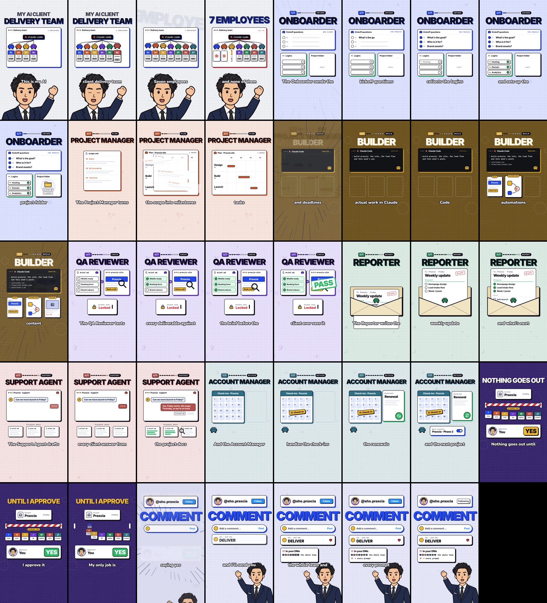
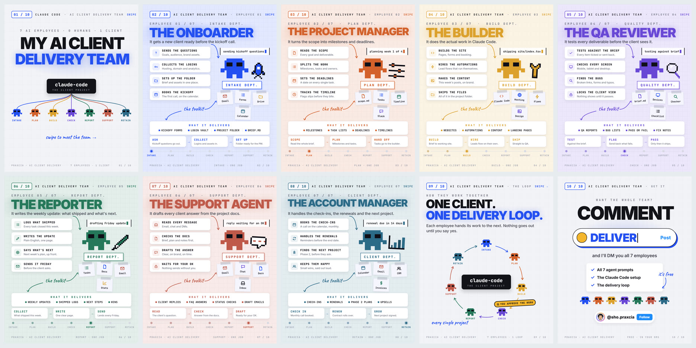
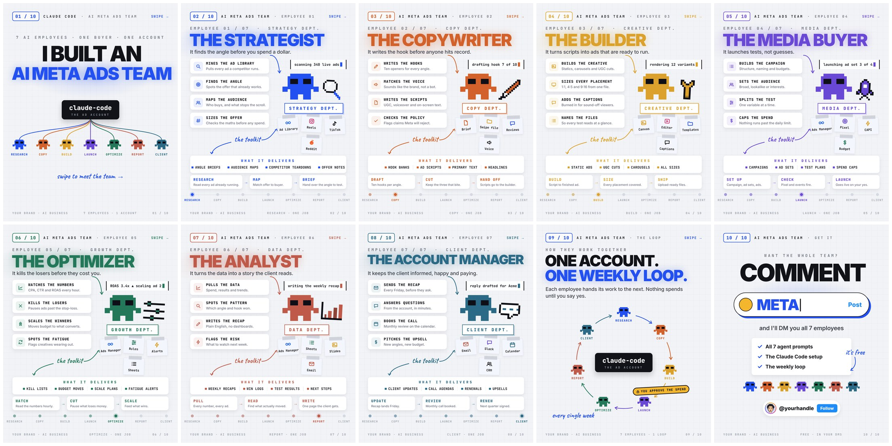
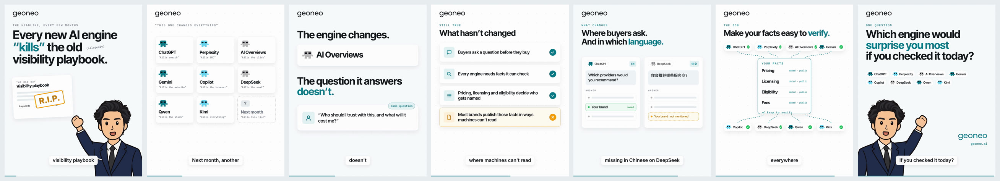
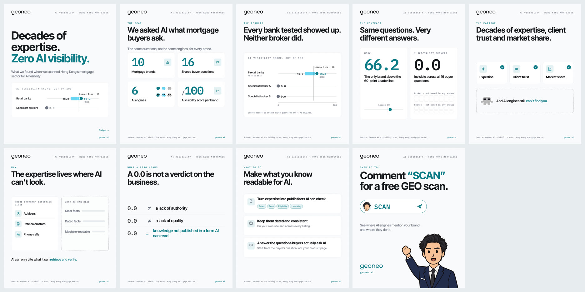

# Video editor — viral explainer reels & carousels with AI agents

Ask Claude Code for a reel or a carousel; it writes the script, designs the
scenes in HTML, voices it, adds music and sound effects, and renders an MP4,
all on your machine, with no paid APIs.

Built on [HyperFrames](https://github.com/heygen-com/hyperframes) (HTML → video
for agents) with a design kit called **Pixel Crew**: pixel-robot "AI
employees", chunky offset-shadow cards, word-synced captions.

## Samples (rebuilt from your references)

| | Project | Output |
| --- | --- | --- |
| | Account | Project | Output |
| --- | --- | --- | --- |
| Reel, 9:16, 38.6 s, voice + music + SFX | Praxcia (`@sho.praxcia`) | `projects/ai-delivery-team` | `samples/ai-delivery-team.mp4` |
| Carousel, 4:5, 10 slides | Praxcia (`@sho.praxcia`) | `projects/praxcia-delivery-team` | `samples/praxcia-delivery-team/slide-01…10.png` and `.mp4` |
| Carousel, 4:5, 10 slides | (capability sample) | `projects/ai-meta-ads-team` | `samples/ai-meta-ads-team/slide-01…10.png` and `.mp4` |
| LinkedIn reel, 4:5, 34 s | Geoneo (`geoneo.ai`) | `projects/geoneo-engines` | `samples/geoneo-engines.mp4` + `.srt` |
| LinkedIn carousel, 4:5, 9 slides | Geoneo (`geoneo.ai`) | `projects/geoneo-hk-mortgage` | `samples/geoneo-hk-mortgage/geoneo-hk-mortgage.pdf` + PNGs |

Two accounts: **Praxcia** (`@sho.praxcia`, Pixel Crew look) and **Geoneo**
(`geoneo.ai`, its own brand layer). Your cartoon host appears on both. Handles
are set in `projects/*/script.json` and `projects/*/slides.js`. The Praxcia reel
is our own cut of the reference: Praxcia as the client, each employee scene
tinted to its robot's colour, and its own chiptune (`music.seed`).

Reel, one frame per second:



Praxcia carousel (the reel's team as 10 slides):



Carousel capability sample:



Geoneo reel ("The engine changes") and carousel ("Decades of expertise. Zero AI visibility."),
built on the client brand layer in `kit/brands/geoneo/`:





## Quick start

```bash
npm install                       # HyperFrames, GSAP, fonts, puppeteer-core
bash scripts/get-models.sh        # Kokoro TTS model (~350 MB) + Python deps
node scripts/build.mjs projects/ai-delivery-team     # → renders/ai-delivery-team.mp4
node scripts/carousel.mjs projects/ai-meta-ads-team  # → renders/ai-meta-ads-team/
```

Needs Node 22+, Python 3.10+, ffmpeg and Chrome/Chromium (HyperFrames finds
one, or run `node scripts/hf.mjs browser ensure`).

## Make your own

In Claude Code, from this folder:

> Make a reel about my 5-agent content team: researcher, writer, designer,
> scheduler, analyst. Keyword: CONTENT. Handle @myhandle.

> Make a carousel about the 6 n8n automations I sell to dentists.

The project skills in `.claude/skills/` (`pixel-crew-reel`,
`pixel-crew-carousel`) walk the agent through script → scenes → snapshot
review → render. By hand:

```bash
node scripts/new.mjs reel my-topic        # copy the sample reel
# edit projects/my-topic/script.json (lines = captions), index.html, scenes.js
node scripts/build.mjs projects/my-topic --no-render --snap 1,5,9   # look first
node scripts/build.mjs projects/my-topic                            # render
```

## How it works

```
script.json ──► voice.py (Kokoro TTS + word timings) ──► build/timing.js
                                                           │
index.html + scenes.js (GSAP, timed to words) ◄────────────┘
        │──► cues.mjs (exports SFX cues) ──► soundtrack.py (chiptune + SFX + duck + −14 LUFS)
        └──► HyperFrames render (headless Chrome → H.264/AAC) ──► renders/<name>.mp4
```

- Every animation is pinned to a spoken word (`R.word("qa", 1, "deliverable")`),
  so changing the script or voice re-times the whole video.
- Sound effects are emitted by the same helpers that animate, so they can't drift.
- Your own voice: record `build/voice.wav`, run `python3 scripts/voice.py <project> --from-wav`
  (timings are estimated; adjust in `timing.json` if needed).
- Your own music: `build/music-override.wav`. Built-in styles: `"chiptune"` or `"ambient"` (`music.style` in `script.json`).
- Captions also land in `build/captions.srt` for platforms that take a subtitle file (LinkedIn, YouTube).
- Client brands live in `kit/brands/<client>/` (tokens, atoms, logo); carousels export a
  LinkedIn-ready PDF with `node scripts/carousel.mjs projects/<carousel> --png --pdf`.
- Your host: your cartoon in `kit/avatars/` is the default for every reel and carousel
  (set in `kit/brand.js`; preview in `projects/avatar-preview`). Swap the PNGs to change it.
  Drawn fallbacks: `Sprites.presenter({ look: "tee" | "suit" })`.

## Styles

`docs/STYLES.md` covers what each of the seven repos you sent
(HyperFrames, Hypit, Opuscar, ClaudeAnimationBase, Blender skills, gbro
collage, OneTake) can add, plus where three.js helps.
`docs/REFERENCE-BREAKDOWN.md` explains why the reference reel works.
